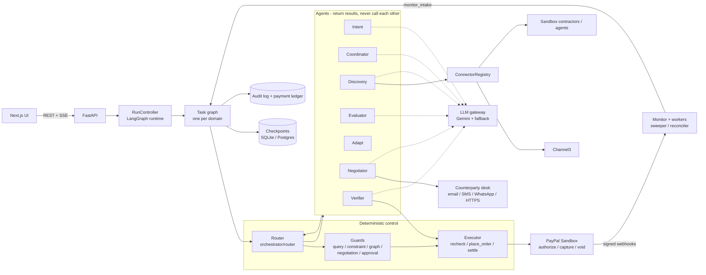
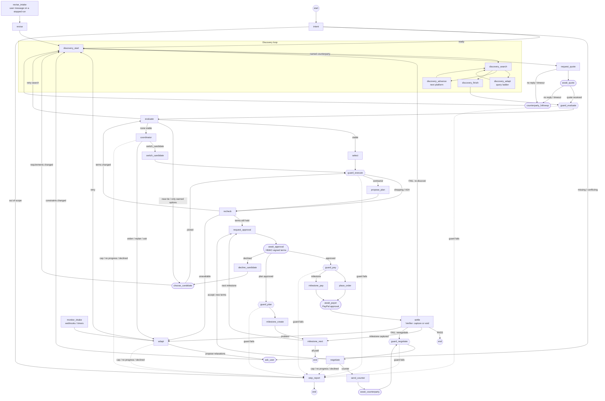

# Agent Architecture

## Components

## Task graph

Node names match `backend/app/orchestrator/graph/builder.py`. Rounded nodes pause the graph with `interrupt()` and wait for the user, the payer or a counterparty.

## Key architecture rules

- **Agents never call each other.** Each node runs one agent or executor step and returns a partial `TaskState` update. Every conditional edge is a function in `orchestrator/router/`.
- **Routing is code.** The LLM only fills strict schemas: extracted intent, query rewrites, scores, a coordinator choice from a closed set, negotiation moves, and verification findings. It never picks a graph edge directly.
- **Guards before every side effect.** `guard_evaluate`, `guard_execute`, `guard_pay`, `guard_plan` and `guard_negotiate` are deterministic checks. Any failure ends at `stop_report` with a reason.
- **Two pauses bracket the money path.** `await_approval` (the user approves the exact terms, which are HMAC-signed) and `await_payer` (the payer approves at PayPal). The approval is valid only for its terms hash, so any change to price, seller, delivery or milestones needs a fresh approval.
- **Verification before capture.** `settle` runs the Verifier. Funds are captured on PASS and voided on FAIL. Contractor runs pay per milestone.
- **Hard constraints change only by the user**, through `ask_user`, `choose_candidate` or `revise`. Agents and untrusted text cannot change them.
- **Untrusted text is isolated.** Listings, reviews, counter-offers and deliverables never reach the Coordinator prompt. Counter-offers are sanitized to machine tokens before the Negotiator sees them.
- **Bounded loops.** Every loop has a cap: iteration cap, discovery ladder, Adapt prompt cap (2), negotiation rounds and verifier passes. A repeated `progress_hash` means no progress and stops the run with an explanation.
- **Durable and resumable.** LangGraph checkpoints (SQLite or Postgres) persist state at every node. Nothing with side effects runs before an `interrupt()`, because LangGraph re-runs that node when it resumes.
- **One engine, three domains.** Shopping, contractor and A2A use the same graph. Domain differences live in plug-ins (`backend/app/domains`): plan template, verification spec, monitor spec and terms. The contractor graph adds the milestone branch, and contractor/A2A runs add the quote and negotiation branches.
- **Post-purchase events re-enter the graph.** The Monitor worker turns webhook and timer events into `monitor_intake` → Adapt. Funds are released (void or refund) before any replan.
