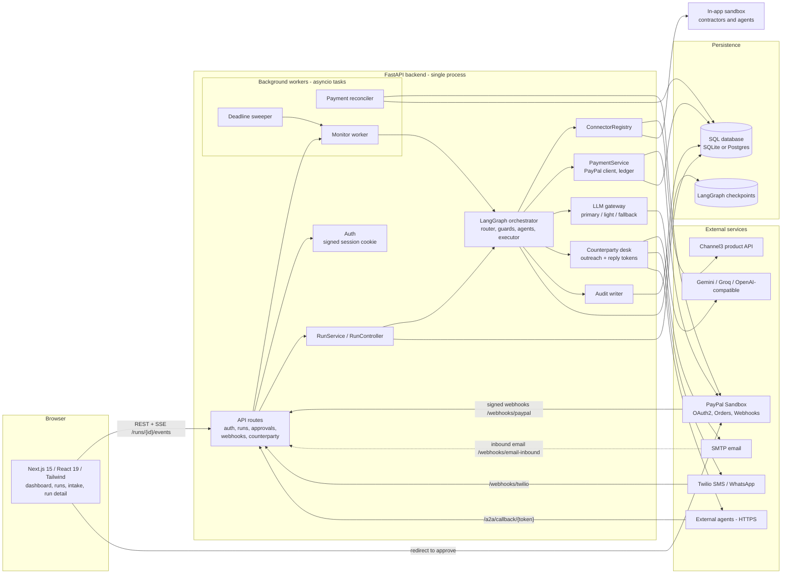
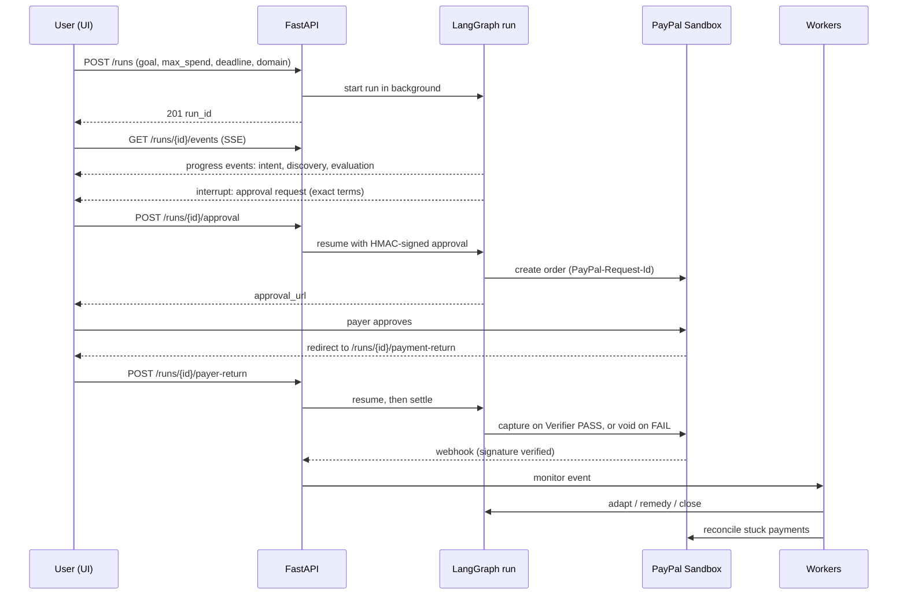
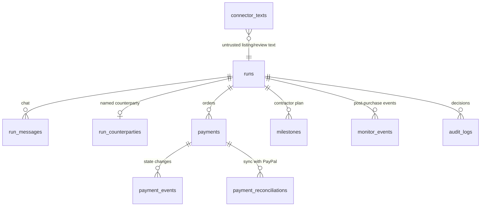

# Project Architecture

## System overview



## Request lifecycle



## Repository layout

```
PayPal-AI/
├─ frontend/                 Next.js app
│  └─ src/
│     ├─ app/                routes: (marketing) landing, (app) dashboard, runs, runs/new, runs/[runId]
│     ├─ features/           approvals, candidates, chat, intake, milestones, payment, plan, runs
│     ├─ hooks/              data hooks (useRun, useChat, useApproval, ...)
│     └─ lib/                api client, SSE client/parser, PayPal approval redirect
├─ backend/
│  ├─ app/
│  │  ├─ api/                FastAPI app, routes, bootstrap (composition root)
│  │  ├─ auth/               sandbox sessions, external JWT auth
│  │  ├─ runs/               RunService, run views
│  │  ├─ orchestrator/       graph, router, guards, agents, executor, prompts
│  │  ├─ domains/            shopping, contractor, A2A plug-ins
│  │  ├─ connectors/         Channel3, sandbox, test mocks, registry
│  │  ├─ counterparty/       outreach desk, transports, reply tokens, SSRF guard
│  │  ├─ payments/           PayPal client, payment service, reconciliation
│  │  ├─ monitor/            event processor, timers, webhook verification, remedy
│  │  ├─ workers/            monitor, reconciler, sweeper
│  │  ├─ llm/                provider gateway and deadlines
│  │  ├─ audit/              audit events, signed approvals
│  │  ├─ db/                 models, Alembic migrations, session
│  │  ├─ sandbox/            in-app demo counterparties
│  │  └─ schemas/            Pydantic contracts
│  └─ tests/                 unit, integration, adversarial, eval suites
├─ infra/docker-compose.yml  Postgres 16
├─ docs/TEST_SCENARIOS.md
└─ start.bat / stop.bat
```

## Data model



## Key architecture points

- **Composition root.** `backend/app/api/bootstrap.py` builds the connectors, LLM providers, PayPal client, graphs (one per domain) and workers, and installs them on `app.state`. Startup fails fast and names any missing required setting.
- **Single deployable backend.** The API, the LangGraph runtime and the background workers (deadline sweeper, payment reconciler, monitor) run in one FastAPI process as asyncio tasks, and stop gracefully on shutdown.
- **Durable runs.** LangGraph checkpoints (SQLite or Postgres) let a run pause for days (approval, payer, counterparty reply) and resume after a restart. Business data lives in SQL tables managed by Alembic migrations.
- **Live updates over SSE.** The UI streams `GET /runs/{id}/events`, and user actions (messages, approvals, cancel, confirm delivery) are plain REST calls that resume the graph.
- **Layering.** Routes stay thin and call `RunService`. Agents never touch HTTP or the database directly. Connectors, payments, counterparty transports and LLM providers sit behind small protocols, so tests swap in fakes.
- **Domain plug-ins.** Shopping, contractor and A2A share one engine. Each plug-in supplies a plan template, required fields, verification spec, monitor spec and payment terms.
- **Payment safety:**
  - Authorize → verify → capture or void.
  - Approvals are HMAC-signed over the exact terms and consumed once.
  - Every PayPal mutation is idempotent (`PayPal-Request-Id`).
  - Webhook signatures are verified against `PAYPAL_WEBHOOK_ID`.
  - A reconciler keeps the local ledger in line with PayPal.
- **Security boundaries:**
  - Every query is scoped to the authenticated principal.
  - CORS allows exact origins only.
  - Secrets come from environment variables.
  - Untrusted text (listings, reviews) is stored separately in `connector_texts` and never reaches control prompts.
  - Outbound counterparty calls pass an SSRF guard (`counterparty/netguard.py`).
  - Inbound Twilio and email webhooks are signature- or secret-checked.
- **LLM resilience.** One gateway serves several providers: the primary (Gemini by default), an optional light model for cheap calls, and an automatic fallback on overload, error or quota exhaustion. A per-run LLM time budget skips optional LLM steps instead of failing.
- **Auditability.** Every decision, constraint revision, approval and payment event is written to `audit_logs` in the same transaction as the change.
